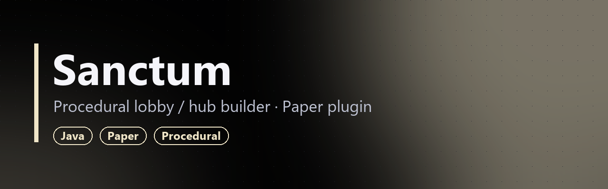
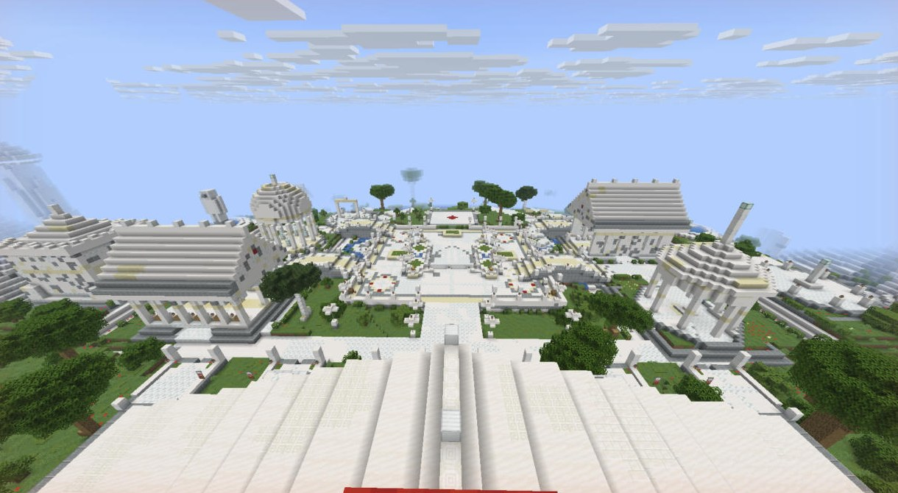

**[Русский](#русский) · [English](#english)**

> 🔒 Исходный код закрыт. В репозитории только описание плагина.
> 🔒 Source code is private. This repo contains a showcase only.

### Скриншоты с тестового сервера / Test server screenshots

_Результат `/sanctum build` на Paper 26.1.2: 63 000 блоков / result of `/sanctum build` on Paper 26.1.2: 63,000 blocks._

---

## Русский

**Sanctum** — плагин-строитель лобби для Paper (1.21). По команде `/sanctum build` он возводит в мире сервера светлое святилище железных хранителей: центральную площадь, ряд NPC, фасады, рынок, галереи, мосты через речку и декоративные сады.

### Особенности
- **Нужен только на время стройки.** Блоки ставятся в обычный мир, после постройки мир живёт сам и плагин можно удалить.
- **Раскладка в одном месте.** Все площадки объявлены один раз в общей раскладке с размером «пятна» вместе с цоколем и ступенями. При сборке плагин проверяет реальный просвет между прямоугольниками, а не расстояние между центрами, так что постройки не налезают друг на друга.
- **Метки из мира.** Команда обходит карту, находит вручную поставленные блоки-метки и печатает их координаты, сгруппированные по кучкам. Объяснить словами, где поставить статую, сложно, а поставить блок быстро.
- **Правки по ТЗ.** Отдельный режим хаба с одной площадью и плотным рядом NPC. Прежняя планировка остаётся доступной.

**Команды:** `/sanctum build | tp | info`.

---

## English

**Sanctum** is a lobby-builder plugin for Paper (1.21). `/sanctum build` raises a bright sanctuary of iron guardians in the server world: a central plaza, a row of NPCs, facades, a market, galleries, bridges over a stream and decorative gardens.

### Highlights
- **Only needed while building.** Blocks go into the normal world, the world lives on by itself afterwards, and the plugin can be removed.
- **One layout file.** Every site is declared once, together with its footprint including plinth and steps. At build time the plugin checks the real clearance between rectangles rather than center-to-center distance, so structures never overlap.
- **In-world markers.** A command scans the map for hand-placed marker blocks and prints their coordinates, clustered into groups. Describing where a statue should go is hard, but placing a block is quick.
- **Spec revisions.** A separate hub mode with a single plaza and a dense NPC row. The previous layout stays available.

**Commands:** `/sanctum build | tp | info`.
